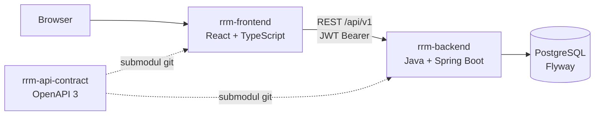

# Research Resource Manager

**Platformă web pentru rezervarea resurselor de cercetare**: echipamente speciale, roboți educaționali și spații de laborator, cu orele consumate din granturile de cercetare.

Proiect realizat de echipa **student-team-origin** la disciplina **Ingineria Programelor**, Universitatea „Ștefan cel Mare” din Suceava, 2026–2027.

---

## Ce rezolvă

Într-un departament de cercetare, echipamentele (brațe robotice, imprimante 3D, osciloscoape, săli de laborator) sunt folosite de studenți și cercetători din mai multe granturi. Fără o platformă comună apar rezervări suprapuse, ore de grant consumate fără evidență și aprobări pierdute pe e-mail.

Research Resource Manager oferă:

- **un catalog comun** al resurselor din toate laboratoarele, cu starea fiecăreia (activă, în mentenanță, defectă);
- **calendarul de disponibilitate** al fiecărei resurse, pe zi, săptămână și lună;
- **rezervări fără suprapuneri**, garantate de baza de date (hard lock), inclusiv timpul de pregătire dintre două rezervări;
- **aprobare pe 2 niveluri**: întâi Coordonatorul grantului (orele și relevanța pentru proiect), apoi Responsabilul laboratorului (echipamentul și siguranța);
- **soldul de ore al fiecărui grant**, actualizat la fiecare cerere, aprobare sau anulare;
- **acces pe roluri cu scop**: un coordonator gestionează doar granturile lui, un responsabil doar laboratorul lui.

## Arhitectura



Contractul API este scris o singură dată, în `rrm-api-contract`, și inclus ca submodul git în ambele aplicații. Frontend-ul își generează tipurile TypeScript din el, iar backend-ul îl implementează. Orice endpoint nou se adaugă întâi în contract.

## Repository-uri

| Repository | Ce conține | Tehnologii |
|---|---|---|
| [**rrm-backend**](https://github.com/student-team-origin/rrm-backend) | API-ul REST: autentificare, catalog, rezervări, aprobări, granturi | Java 21, Spring Boot 4.1, Spring Security + JWT, Spring Data JPA, PostgreSQL, Flyway, Lombok, JUnit 5 |
| [**rrm-frontend**](https://github.com/student-team-origin/rrm-frontend) | Interfața web (SPA) | React 18, TypeScript 5, Vite, Material UI, TanStack Query, React Hook Form + Zod, FullCalendar, Vitest |
| [**rrm-api-contract**](https://github.com/student-team-origin/rrm-api-contract) | Contractul API comun | OpenAPI 3.0, Redocly |

Fiecare repository are în README secțiunea **Pornire rapidă**, cu pașii de instalare și rulare locală.

## Pornire rapidă

```bash
# 1. Clonarea, împreună cu submodulul de contract
git clone --recurse-submodules https://github.com/student-team-origin/rrm-backend.git
git clone --recurse-submodules https://github.com/student-team-origin/rrm-frontend.git

# 2. Backend (PostgreSQL pornit, baza rrm_dev creată – vezi README-ul backend-ului)
cd rrm-backend && ./mvnw spring-boot:run

# 3. Frontend, în alt terminal
cd rrm-frontend && pnpm install && pnpm dev
```

Aplicația pornește la `http://localhost:5173`. Utilizatorii din datele de test au parola `parola123`:

| Utilizator | Rol |
|---|---|
| `andrei.popescu@student.usv.ro` | Student, membru al grantului PN-III-P4-2026 |
| `elena.marin@usv.ro` | Coordonator al grantului ERASMUS-DIGILAB |
| `ana.rusu@usv.ro` | Responsabil al Laboratorului Electronică (are 2FA activ în datele de test) |

## Stadiul proiectului

**Versiunea MVP** (laboratoarele 7–9):

| Funcționalitate | Backend | Frontend |
|---|:---:|:---:|
| Autentificare cu e-mail și parolă, sesiune JWT, deconectare | ✅ | ✅ |
| Control acces pe roluri cu scop (RBAC) | ✅ | ✅ |
| Catalogul de resurse: căutare, filtre, adăugare, editare, schimbarea stării | ✅ | ✅ |
| Calendarul de disponibilitate | ✅ | ✅ |
| Pagina Detaliu resursă | ✅ | 🔄 |
| Crearea cererii de rezervare (hard lock, sold de ore) | ✅ | 🔄 |
| Rezervările mele și anularea | ✅ | ✅ |
| Fluxul de aprobare pe 2 niveluri | ✅ | ✅ |
| Granturile, cu soldul de ore | ✅ | — |

**Versiunea 1.0** (planificată): autentificare în doi pași (TOTP / cod pe e-mail), integrare SSO universitar, atașamente PDF, check-in și anulare automată, notificări (e-mail și în aplicație), administrarea utilizatorilor și a granturilor, rapoarte de utilizare și export PDF / Excel.

✅ gata · 🔄 în lucru · — nu se aplică

## Cum lucrăm

- **Jira** (proiectul `TO`): fiecare modificare pornește de la un tichet, grupat în epicuri (Autentificare și Securitate, Catalog Resurse, Motor de Rezervări, Rapoarte și Analitică).
- **Ramuri:** `<tip>/TO-<nr>-descriere`, de exemplu `feature/TO-40-api-creare-rezervare`. Nimeni nu scrie direct pe `main`.
- **Commit-uri:** Conventional Commits cu cheia tichetului, de exemplu `feat(rezervari): TO-40 API creare rezervare cu hard lock`.
- **Pull request:** după template-ul din fiecare repository, cu cel puțin o aprobare și integrat cu **Squash and merge**.
- **Calitate:** Google Java Style (Spotless + Checkstyle) în backend, ESLint + Prettier în frontend, teste unitare și de integrare la fiecare PR.
- **Documentație:** cerințele (PRD), arhitectura, diagramele UML și ghidul de dezvoltare sunt în Confluence; wireframe-urile și prototipul, în Figma.

## Echipa

| Membru | GitHub | Rol |
|---|---|---|
| Vladislav Shorodok | [@shorodokvlad](https://github.com/shorodokvlad) | Team Leader · autentificare, securitate, integrare |
| Tudor Baciu | [@BaciuTudor](https://github.com/BaciuTudor) | Motorul de rezervări, catalog și calendar |
| Yaroslav Chernov | [@chernov-y](https://github.com/chernov-y) | Rezervările mele, fluxul de aprobare |

---

<sub>Proiect didactic – Ingineria Programelor, Universitatea „Ștefan cel Mare” din Suceava.</sub>
